# lay4flow-remote

**把 Flow 与 Vids 的图片、视频、语音创作，接到同一个工作台和 API。**

支持 AT 自动续期、Cloak 持久登录、登录态 JSON 导入导出、多账号聚合、固定代理、商务 SKU，以及带作品历史和图片编辑器的可视化工作台。Flow 验证码固定使用 **[远程有头打码服务](https://cap.tk218.top/)**，点击申请 API Key 后填入设置即可。

[快速部署](#快速部署) · [Windows 一键安装](#windows-一键安装) · [Docker 在线更新](#docker-在线更新) · [打码申请与配置](#打码申请与配置) · [界面预览](#界面预览) · [账号与自动续期](#账号与自动续期) · [登录态导入导出](#登录态导入导出免重复登录迁移) · [API 接入](#api-接入) · [完整文档](#完整文档) · [社区](#社区) · [QQ 交流群](#qq-交流群)

本次修复与行为说明见[更新记录](docs/CHANGELOG.md)。

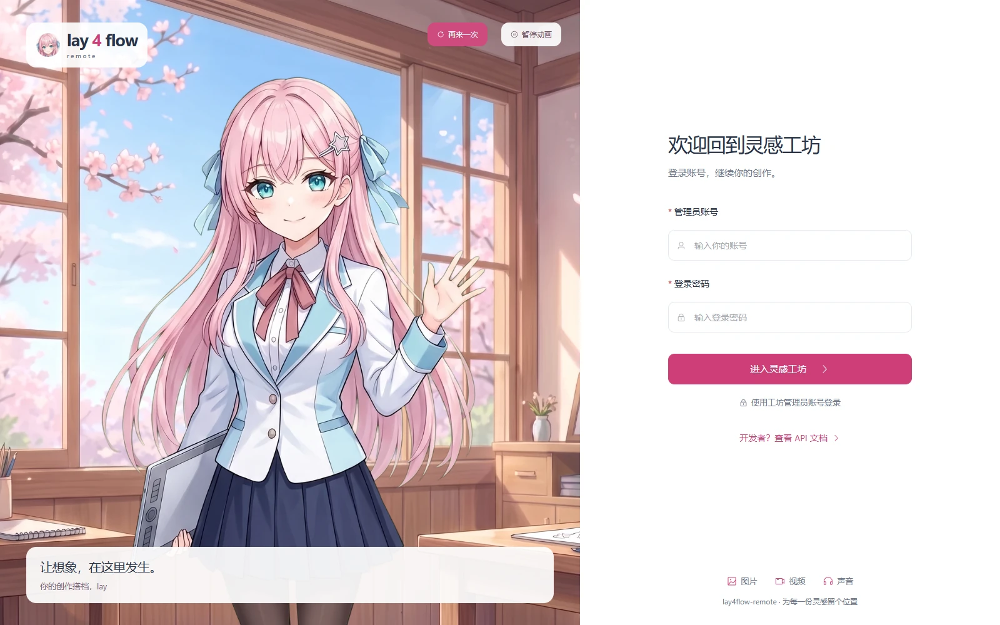

## 能做什么

| 能力 | 已实现内容 |
|---|---|
| **Flow 多账号聚合** | Nano Banana、Imagen、Veo 3.1、Omni 1.1；按账号状态、媒体开关和并发额度调度，支持顺序轮询 |
| **AT 自动续期** | 请求前检查并续期；启用自动刷新后后台每分钟检查，在 AT 剩余不足 1 小时时提前维护；认证失效时触发刷新 |
| **持久登录** | Cloak 有头浏览器直登，每个账号独立 Profile 与稳定浏览器身份；重启后继续使用已有登录态 |
| **免重复登录迁移** | JSON 导出 Cookie、站点存储和 IndexedDB，在匹配环境的服务器上导入、重建 Profile、续签并验证后使用 |
| **Vids 媒体服务** | 图片生成与上传编辑、六种视频模式、30 个语音声线；账号池、额度查询、会话恢复和原结果下载 |
| **多协议 API** | OpenAI Chat / Responses / Images / Videos，Gemini GenerateContent / SSE；独立 Vids provider 与商务 SKU 入口 |
| **商务固定 SKU** | New API / One API 接入；按模型、质量、时长、分辨率固定规格，成功结果返回固定结算单位 |
| **创作工作台** | Flow / Vids 切换、图片与视频每批 1–20 份后台生成、参考素材、作品画廊、批量下载、历史恢复、原成品作为参考继续创作 |
| **本地图片编辑器** | 裁剪、旋转、翻转、画笔、橡皮、撤销重做、PNG 导出；编辑后直接作为参考图或提交 AI 编辑 |
| **统一代理池** | 账号固定出口与媒体独立分配；SOCKS5 / HTTP、每行一个批量导入、去重、健康检查和批量启停 |
| **运维与观察** | 账号积分与 Vids 配额、生成日志、异常状态、缓存管理、健康检查、Prometheus 指标、Docker 持久化部署 |

## 界面预览

以下为**当前版本真实界面**，由可复现脚本在隔离预览服务中拍摄。账号、代理、配额和历史记录均为演示数据；图片示例使用仓库自带的 lay 插画，语音卡片使用本地合成演示音。

### 总览与创作工作台

总览集中展示账号状态、Flow 积分、Vids 可用额度与近期请求；创作工作台把参数、参考素材和作品放在同一页。

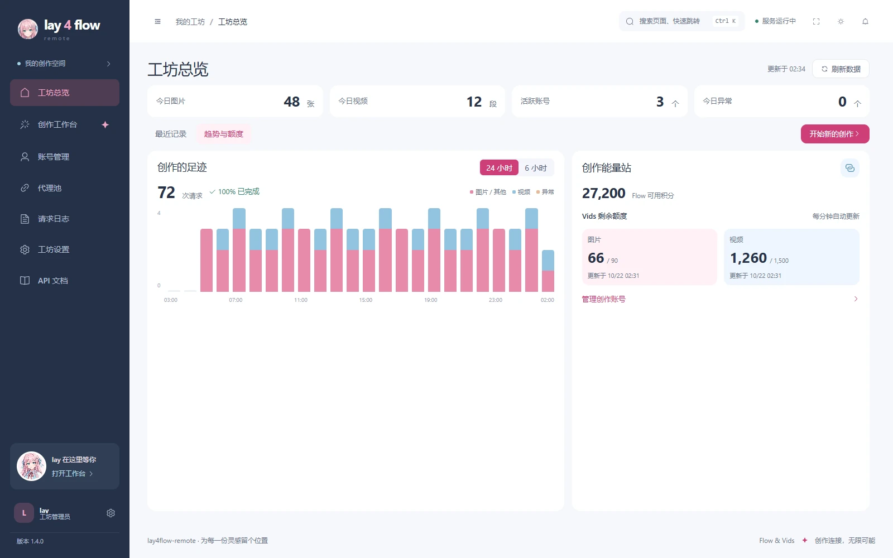

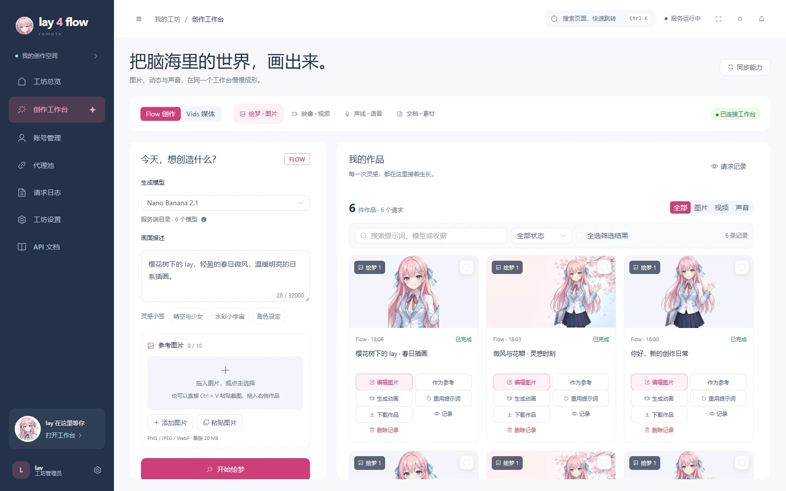

<details>
<summary>查看图片编辑器与 Vids 语音工作台</summary>

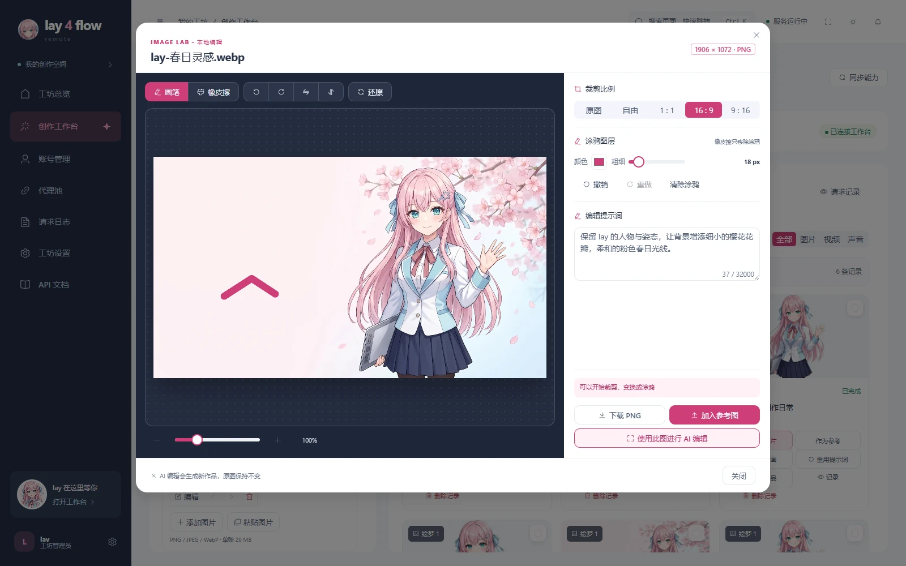

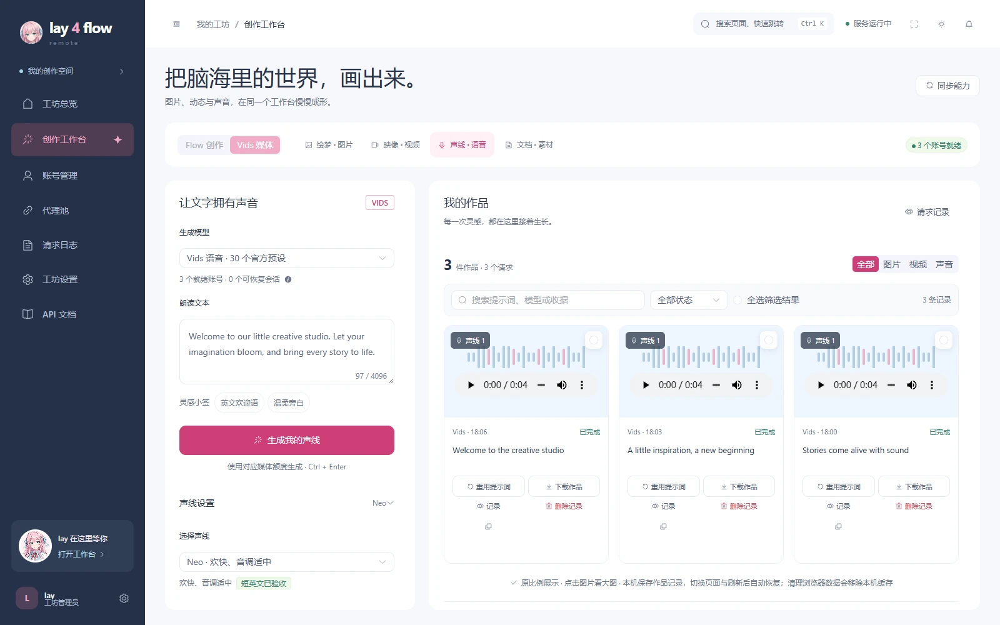

</details>

### 账号与登录态迁移

同一页查看 Flow / Vids 状态、AT 有效期、自动维护、账号绑定和配额。通过 JSON 导入导出迁移已有登录态。

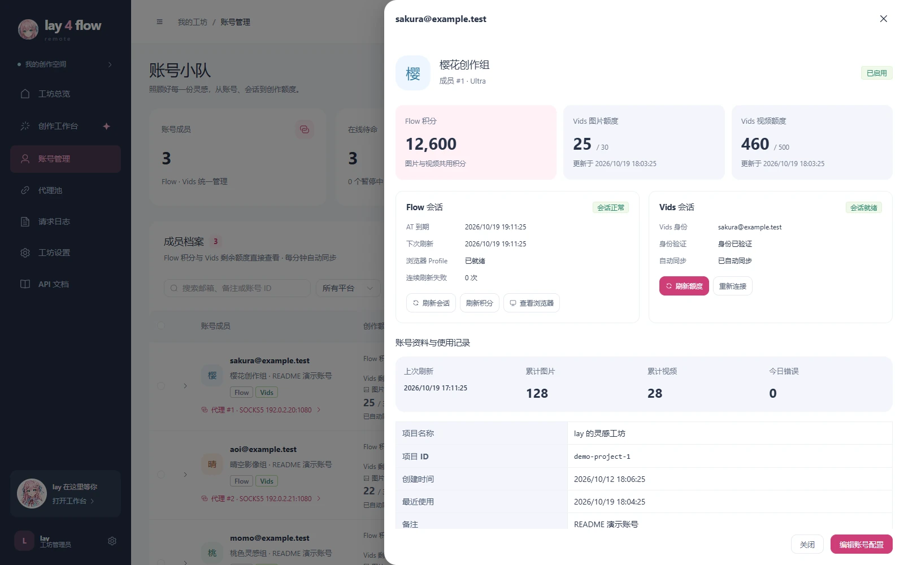

<details>
<summary>查看登录态导入界面</summary>

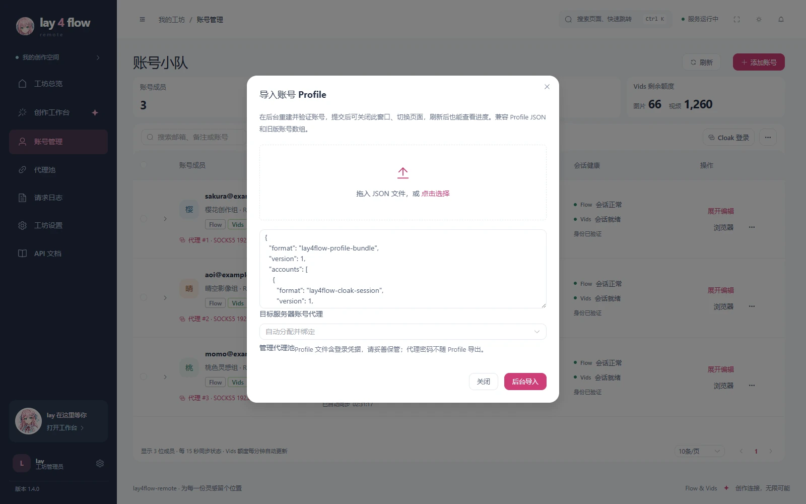

</details>

### 版本与更新入口

左下角版本号打开更新日志抽屉，集中展示当前版本与逐版变更；桌面端在抽屉中检查并立即更新，检查线上版本由用户手动触发，不影响创作任务。

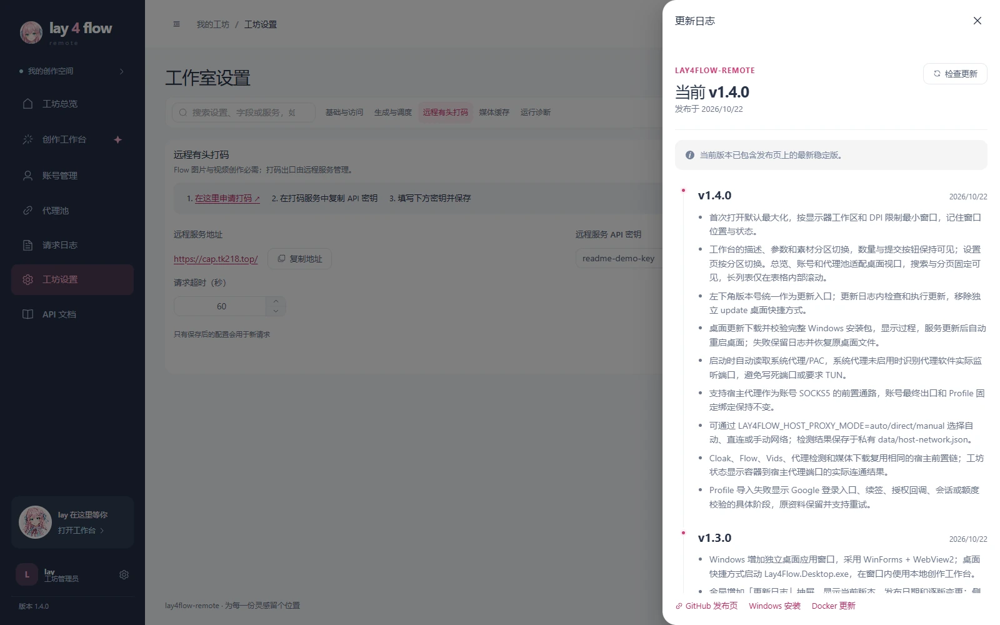

### 代理池与 API 文档

代理池支持批量导入与逐行错误反馈。API 文档按 Flow、Vids、商务 SKU 分组，提供可复制的请求示例。

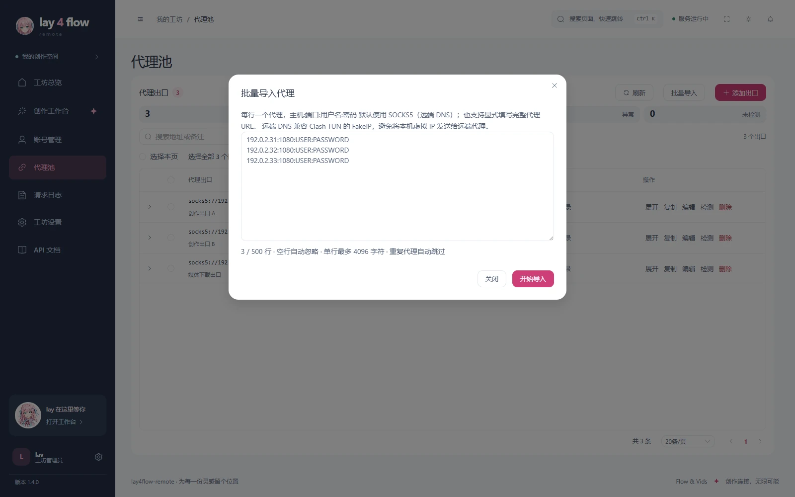

<details>
<summary>查看 API 文档、远程服务设置与手机界面</summary>

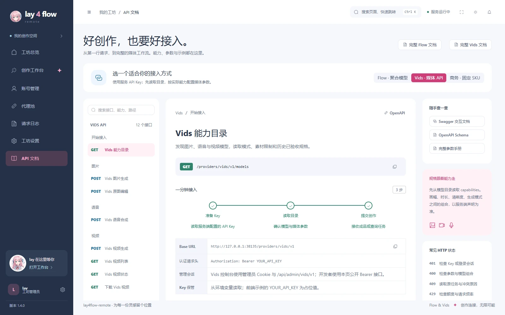

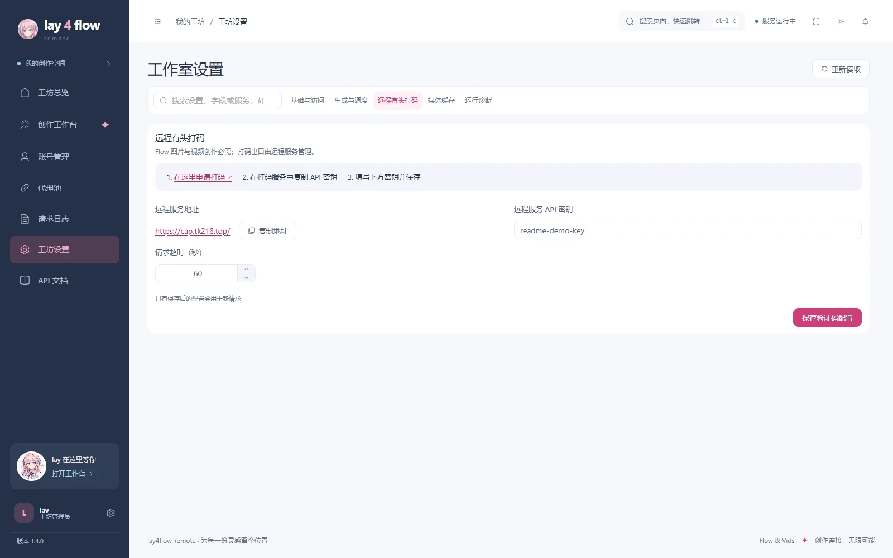

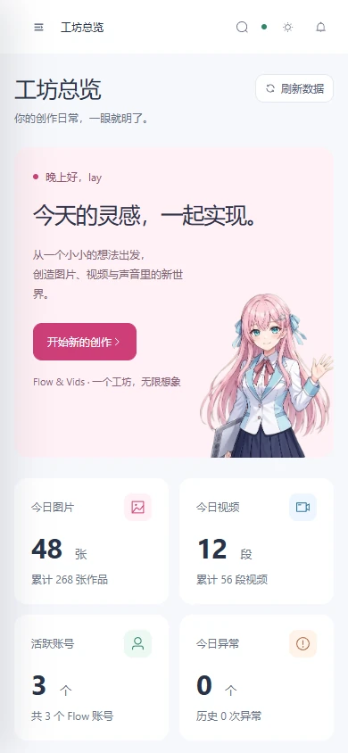

</details>

## 打码申请与配置

**Flow 图片、视频生成必须先配置打码 API Key。** 服务地址固定为 **<https://cap.tk218.top/>**，点击链接即可前往申请。

1. 打开 **[打码服务申请入口](https://cap.tk218.top/)**，申请并取得 API Key。
2. 登录工作台，进入「工坊设置 → 远程有头打码」，填写申请到的 **API Key** 并保存；超时默认 60 秒，可按需调整。
3. 配置完成后使用 Flow 生成。未添加 Key 时，登录后的全局提醒会提供申请链接与设置入口。

本发行版固定连接该服务，用户只需配置 Key 与超时；仓库包含客户端，不包含远程打码服务端。Vids 使用独立会话、账号池与配额，其接入状态在账号管理中查看。

## 快速部署

### Windows 一键安装

Windows 双击 `lay4flow-remote-版本-windows-x64-setup.exe` 安装，或解压 ZIP 后双击 **`install.cmd`**。**安装包自带后台、Python 运行时、依赖和 Cloak 浏览器，用户无需安装 Docker、Python、Node、Git 或 .NET。** 桌面快捷方式直接打开创作工作台，左下角版本号提供更新日志和在线升级；安装器与桌面程序沿用 TkCRM 同款图标。WebView2 缺失时由安装器引导安装微软官方组件，正式发布资产位于 [GitHub Releases](https://github.com/TheLayya/lay4flow/releases)。

默认安装到 `%LOCALAPPDATA%\lay4flow-remote`，账号和密码均为 **`admin`**。Windows 安装器会自动探测系统代理、PAC 和 Clash / Mihomo / sing-box 的真实监听端口，不写死 `7890`；可通过 `.env` 的 `LAY4FLOW_HOST_PROXY_MODE=auto|direct|manual` 控制，手动模式填写 `LAY4FLOW_HOST_PROXY`。详细的启动、更新、停止与保留数据卸载方式见 [Windows 安装指引](docs/WINDOWS_INSTALL.md)。

### Docker 在线更新

已有部署在宿主机运行更新脚本，先下载并校验发布包、构建候选，再备份和切换应用；健康或版本检查失败会回滚。

```powershell
# Windows，在部署目录运行
powershell -NoProfile -ExecutionPolicy Bypass -File scripts/update.ps1 -InstallDir .
```

```sh
# Linux，在部署目录运行
bash scripts/update.sh --install-dir .
```

更新保留持久数据与配置，单实例切换会短暂重启。升级前结束生成与导入任务；回滚命令、备份位置和首次接入旧版的操作见 [Docker 更新指引](docs/DOCKER_UPDATE.md)。运行中可点击左下角版本号或 **工坊设置 → 版本与更新** 查看当前版本、变更记录和立即更新。

### 1. 准备 Docker 与打码 API Key

需要 Docker Engine 和 Compose v2 或更新版本。镜像包含 Cloak 浏览器、虚拟显示与网页账号浏览器，前端由同一 Python 服务提供。

先在 **[打码服务](https://cap.tk218.top/)** 申请 API Key，配置步骤见[打码申请与配置](#打码申请与配置)。容器内 Cloak 用于账号登录、Profile 持久化和会话维护。Flow 生成时通过 `remote_browser` 向固定服务请求验证码；请求格式见[服务契约](docs/REMOTE_BROWSER_FINGERPRINT.md)。

### 2. 创建本机配置

```sh
cp config/setting_example.toml config/setting.toml
cp .env.example .env
```

Windows PowerShell 对应命令：

```powershell
Copy-Item config/setting_example.toml config/setting.toml
Copy-Item .env.example .env
```

在私有文件 `config/setting.toml` 中配置：

| 配置项 | 用途 |
|---|---|
| `global.api_key` | 自行设置服务 API Key，替换 `__configure_api_key__`；外部客户端使用此 Key |
| `global.admin_username` / `global.admin_password` | **默认 `admin` / `admin`**，部署后在「工坊设置」自行修改 |
| `captcha.remote_browser_api_key` | 在 [打码服务](https://cap.tk218.top/) 申请的独立 Key，通过 `clientKey` 绑定请求，与本服务 API Key 分开 |
| `captcha.remote_browser_timeout` | 远程验证码服务超时，默认 60 秒 |
| `server.public_base_url` | 可选，反向代理后的公开服务地址 |

打码地址固定为 `https://cap.tk218.top/`，无需填写地址。也可先启动并登录管理页，再在「工坊设置 → 远程有头打码」填写打码 Key；缺少 Key 时显示全局配置提醒，Flow 生成需先补齐。

### 3. 构建并启动

```sh
docker compose up -d --build
docker compose ps
docker compose logs -f app
```

打开 **<http://127.0.0.1:38000>**，使用 **`admin` / `admin`** 登录。端口在 `.env` 中通过 `LAY4FLOW_REMOTE_PORT` 修改；例如 `LAY4FLOW_REMOTE_PORT=38001`。

Compose 默认仅监听本机。公网部署在前方配置 HTTPS 反向代理，并转发 WebSocket，让内嵌账号浏览器正常工作。首次构建会下载固定摘要的 Cloak 基础镜像和 Python 依赖。

管理员登录默认保持 30 天，刷新、重开浏览器和更新容器后继续有效。会话保存在持久化 `data/` 内，只保存随机令牌的哈希；主动退出或修改管理员密码后立即失效。使用独立的产品 Cookie，减少同一主机不同端口的后台登录互相覆盖。

首次启动从 TOML 初始化数据库；后续在工作台保存的设置由数据库持久化。更新 TOML 或重建容器会保留数据库中的管理员设置。

### 4. 接入第一个账号

1. 打开「代理池」，添加可用出口，或批量粘贴 `IP:端口:用户名:密码`，每行一个。未写协议默认 **SOCKS5（远端 DNS，`socks5h://`）**，由代理解析目标域名，兼容 Clash TUN 的 FakeIP；显式 HTTP / HTTPS / SOCKS5 / SOCKS5H URL 保留原协议。每次最多 500 行，空行忽略、重复项跳过、失败行保留重试。
2. 在「账号管理」点击「添加账号」，先选择账号代理，再打开 Cloak 完成 Google 登录；留空时自动分配。住宅代理先加入代理池，即可在这里指定。
3. 保存后进行身份、会话、额度与项目验证；验证通过的账号进入调度。已有登录态可通过 JSON 导入，步骤见下文。
4. 在「工坊设置 → 远程有头打码」填写从 [打码服务](https://cap.tk218.top/) 申请的 API Key，然后进入「创作工作台」生成 Flow 图片或视频。
5. 需要 Vids 时，在账号页查看接入状态、额度与失败原因，完成接入后切换工作台中的 Vids。

使用 Clash TUN 时，如果 SOCKS5 检测超时，先检查 DNS：`socks5://` 在本地解析域名，可能将 `198.18.0.0/15` 范围内的 FakeIP 发送给远端代理；`socks5h://` 由远端代理解析域名，可直接在代理池编辑协议后重试。

Cloak 的页面和共享 Cookie 的后台会话请求使用同一个账号出口；SOCKS 与带认证的 HTTP 代理通过账号独立的本机回环桥转发，代理域名由远端解析。

也可以使用「扩展登录」在自己的指纹浏览器完成登录：下载当前管理地址专用扩展 ZIP，解压并加载扩展；在指纹浏览器打开同一个管理页，直接开始扩展登录。Google 登录使用指纹浏览器已经配置的网络与代理，管理页无需再次选择；默认沿用当前指纹环境与 Google 登录态，也可使用临时无痕窗口。扩展不会读取或修改浏览器代理配置。登录态交给服务端后，服务端按现有规则分配账号固定出口，校验真实身份并保存持久化 Cloak Profile，检查正常关闭、重开后的登录态。扩展仅处理账号登录，验证码继续使用远程服务。更换管理地址或端口后需要重新下载扩展。

动态住宅代理应配置同一账号的粘性会话，让浏览器登录、服务端验证和后续请求尽量保持同一出口；登录成功率与真实代理环境需要单独验收。
Windows 桌面端启动时自动读取系统代理/PAC，并探测代理程序实际监听端口；支持任意端口，不要求开启 TUN。选中的本机代理作为前置通路，账号最终出口继续使用绑定的 SOCKS5。可在「工坊状态 → 宿主网络」查看地址和端口连通性；直连或手动设置见 [Windows 网络配置](docs/WINDOWS_INSTALL.md)。Windows 原生版使用 `127.0.0.1:实际端口`；Docker 服务器可在 `.env` 指定 `LAY4FLOW_HOST_PROXY=http://host.docker.internal:实际端口` 后重建容器。

## 账号与自动续期

### AT 自动续期，减少手动维护

- **请求自动检查**：生成前确认账号 AT；AT 缺失、有效期未知或剩余不足 1 小时时触发续期，认证拒绝也会尝试强制刷新。
- **后台提前维护**：启用账号自动刷新后，每分钟检查一次到期状态。Cloak 账号按真实 AT 到期时间安排维护，健康会话按需唤醒浏览器；Cookie / 协议账号保留定期 ST 维护。
- **同账号刷新合并**：并发请求共用同一次刷新任务，减少重复启动浏览器和重复续签。
- **失败状态可追踪**：网络故障退避重试；提前续期失败时保留仍有效的 AT。需要重新登录或处理验证时，在账号页显示原因。

### 每个账号保留自己的浏览器与出口

每个 Cloak 账号使用独立持久化 Profile 和稳定的浏览器身份。服务重启后沿用原资料；网页账号浏览器可以处理交互登录与验证，后台续期可复用同账号的活跃浏览器。

账号分别设置图片 / 视频开关与并发上限，支持批量启停、刷新、删除和导入导出。固定出口在账号建立时确定，也可手动选择；登录、续期和 API 使用同一绑定。绑定出口异常时会报告错误，账号保持原出口关系。成品媒体下载由代理池独立分配，验证码浏览器的网络在远程服务侧管理。

在账号展开面板的「生成提交出口」可选「账号固定代理」或「代理池随机」。池分配模式为每份 Flow 生成选择一个出口，并在整份任务内保持一致；登录和 AT / Profile 维护继续使用绑定出口。调度优先选择较久未使用的可用出口，再比较正在处理数量；近期成功率用于健康观察。只有代理传输失败连续达到 3 次才熔断，冷却从 30 秒递增到最多 5 分钟；后台每 30 秒扫描、每轮最多探测 3 个到期或空闲出口，探测成功自动恢复。403、429、账号额度与内容错误不计为代理连接失败，代理故障也不计为账号连续错误。

随机模式需要池中有多个有效出口才能分散流量；仅一个出口时仍使用该出口。可在代理池查看近期成功率、处理中数量、连续失败、冷却和重探状态。随机模式只影响 Flow 生成；Vids 与浏览器会话继续沿用已有固定出口。

正常关闭 Profile 后，仅清理可重新生成的浏览器缓存，保留 Cookie、站点存储及 Service Worker CacheStorage。

## 登录态导入导出：免重复登录迁移

**已有 Google 登录态仍有效、源与目标运行环境匹配时，可把账号导出为 JSON，在另一台服务器导入后使用，省去逐个手动登录。**

迁移使用 Cloak 原生浏览器状态，包含 Cookie、站点存储、IndexedDB、稳定身份 seed 和必要账号设置；导入端重建 Profile，重新续签 ST / AT、校验原账号身份，并执行正常关闭与两次冷启动验证。通过后恢复源账号的启用与自动刷新设置，源账号为启用状态时才加入调度。

1. 在源服务的「账号管理」选择需要迁移的 Cloak 账号，使用「导出」下载会话 JSON；支持所选账号或全部账号。
2. 在目标服务准备匹配的 Cloak / Playwright / Chromium 版本和浏览器身份参数，并添加账号出口。
3. 打开「导入」，选择目标代理并粘贴或载入 JSON。会话 bundle、单账号状态、旧账号 JSON 数组及混合列表统一提交后台任务，立即返回；可关闭弹窗、切换页面或刷新，服务端继续处理。
4. 账号页的「后台导入」显示实际阶段、已完成数量、耗时和逐账号结果，其他页面也有任务提示。失败项可直接重试，成功项保持原样；同一账号、浏览器身份和固定代理匹配的失败资料原地继续验证。

后台任务及失败重试资料仅在当前服务内存保留，最近结果最多保留 24 小时 / 100 个任务。服务重启后重新提交 JSON，已导入账号及保留的 Profile 继续存在。

迁移包包含有效登录会话，请按密码保管，保存在私有位置。Google 登出、会话到期、环境变化或验证挑战仍可能要求重新登录。Vids 的绑定与加密会话有独立持久化文件，整机迁移还需备份它们及对应解密密钥。

## Flow 聚合：图片与视频

将多个账号汇入同一模型入口，按模型参数选择模式与规格。当前公开目录包含：

| 模型入口 | 内容 |
|---|---|
| `gemini-3.1-flash-image` | Nano Banana 图片生成与参考图，1k / 2k / 4k |
| `gemini-3.1-flash-image-lite` | Lite 图片入口，1k |
| `gemini-3.0-pro-image` | Pro 图片生成与参考图，1k / 2k / 4k |
| `imagen-4.0-generate-preview` | Imagen 兼容图片入口，1k |
| `veo_3_1` | 文生视频、首帧、首尾帧、参考图、已有媒体续写；fast / quality / lite 与 Relaxed 组合 |
| `omni_1.1_flash` | 文生、首帧、首尾帧、参考图视频，以及源视频编辑与裁剪 |

图片支持最多 10 张参考图；视频的素材数量、时长、分辨率和账号档位要求各不相同。Veo、Omni 使用能力目录里的有效组合；高分辨率可能包含后处理放大步骤。Chat / Gemini 放大失败时可能保留基础成品，应核对实际规格；专用 Images / Videos 和商务 SKU 会校验请求规格，商务 SKU 通过校验后才返回成功结算。具体参数见[模型与参数](docs/FLOW_PUBLIC_MODELS.md)。

### 调度、队列与失败恢复

工作台的图片和视频都可设置生成数量，单批 1–20 份；提交后立即进入后台队列，可继续编辑、提交下一批或离开页面。每份独立显示排队、生成和结果，刷新后恢复服务端状态。Vids 每份使用独立且稳定的幂等键，查询或恢复下载沿用原收据。服务重启后，未执行项标记失败，执行中的项标记待确认，保留结果而不自动重复发送生成请求。

- **按能力选账号**：结合模型需要的账号等级、图片 / 视频开关、剩余并发槽位与 AT 状态筛选，按负载选择或顺序轮转。
- **项目池与预热**：每账号维护 Flow 项目池并轮转使用，缺少时自动补齐；远程验证码服务支持预热请求，预热失败时仍可继续正常生成。
- **有界视频队列**：Flow / SKU 的 Videos 提供后台异步队列、任务列表、进度查询、MP4 下载和终态删除，并设置 worker、排队数量与媒体容量上限。
- **重复请求保护**：相同幂等键与相同请求复用原任务，参数变化返回冲突；重启后进行中的任务标记失败，避免重复提交付费生成。
- **暂态错误处理**：设置中的「最大尝试次数」包含首次提交，每份作品独立计数，验证码异常也遵循此上限。可重试错误在预算内重新获取验证码；失败记录保留逐次尝试和原因。视频轮询错误或超时会终止并保留原因，媒体下载具备独立代理和回退路径。
- **账号健康策略**：连续失败达到配置阈值时自动停用账号，成功请求清零连续错误计数，保留历史统计与失败原因。

## Vids：图片、视频和语音

Vids 是独立 provider，拥有自己的账号池、会话和配额。可在同一工作台切换使用，也可通过独立 Base URL 接入。

| 模型 | 功能 |
|---|---|
| `vids-image` | 文生图，一次 1–4 张；风格与比例选择，URL / Base64 输出；上传原图进行编辑 |
| `vids-video` | **text / animate / ingredients / edit / extend / upscale** 六种模式；上传图片或 MP4，选择时长、比例、分辨率与镜头方式 |
| `vids-speech` | 文字转语音，30 个预设声线、最多 4096 字符，WAV 输出 |

- **账号接入与修复**：已启用、具备图片或视频能力的就绪 Cloak Profile，在导入或刷新后可触发后台接入，按需建立 Vids 文档；接入失败保留原因，也可在账号页显式重试或重新连接。
- **多账号池与配额**：按媒体种类选择可用账号，跳过忙碌账号；提交前检查会话与额度，界面展示 Flow 积分和 Vids 图片 / 视频配额。
- **原收据恢复**：任务认领后固定原账号与原收据。遇到结果待确认或下载失败，查询原收据、恢复原成品下载，保留已发生的生成状态。
- **独立接口**：统一池 `/providers/vids/v1`，指定账号 `/providers/vids/accounts/{token_id}/v1`；管理页面使用管理员会话，外部调用使用服务 Bearer Key。

Vids 生成要求 `Idempotency-Key`。实现支持范围与已验证的上游组合分别列在模型目录中，实际可用性取决于账号权限、配额与上游状态。语音声明 30 个预设声线，逐声线实网验证情况也在目录中单列。完整说明见 [Vids API](docs/VIDS_API.md)。

## 创作工作台与作品管理

在浏览器中选择 Flow / Vids、图片 / 视频 / 语音，填写提示词、拖入参考素材，并按模型能力调整参数。

- **作品画廊**：按类型、状态和提示词筛选，预览、批量下载或删除；复用提示词，把成品作为参考图或视频起点继续创作。
- **图片编辑器**：自由或固定比例裁剪、缩放、旋转、翻转、画笔 / 橡皮、撤销重做；下载 PNG，或直接带回工作台作为参考图进行 AI 编辑。
- **历史与恢复**：本机保留最近 300 条创作记录及仍待确认的 Vids 收据，切页或刷新后恢复；媒体预览缓存与 Flow 服务端成品归档配合使用。
- **下载恢复**：临时链接失效时可尝试从原账号、原记录或 Vids 收据恢复成品，恢复流程沿用原生成结果。
- **桌面与手机**：响应式布局、可折叠侧栏、明暗主题；登录页与导航共用 lay 头像。

## API 接入

各服务入口分别有模型目录，客户端按需求选择对应路径：

| 使用场景 | SDK Base URL / REST 前缀 | 主要接口 |
|---|---|---|
| **Flow 聚合** | `http://127.0.0.1:38000/v1` | Chat、Responses、Images、Videos |
| **Gemini 兼容** | REST 前缀 `http://127.0.0.1:38000/v1beta` | `/models/{model}:generateContent`、`streamGenerateContent` |
| **商务固定 SKU** | `http://127.0.0.1:38000/compat/v1` | Models、Chat、Images、Videos |
| **Vids 账号池** | `http://127.0.0.1:38000/providers/vids/v1` | Models、Images、Videos、Audio Speech、收据恢复 |

### 查询模型与生成图片

```sh
curl http://127.0.0.1:38000/v1/models \
  -H "Authorization: Bearer YOUR_API_KEY"

curl http://127.0.0.1:38000/v1/images/generations \
  -H "Authorization: Bearer YOUR_API_KEY" \
  -H "Content-Type: application/json" \
  -d '{"model":"gemini-3.1-flash-image","prompt":"窗边的一只猫，柔和水彩插画","n":1,"response_format":"url"}'
```

### 使用 OpenAI Python SDK

```python
import os
from openai import OpenAI

client = OpenAI(
    base_url="http://127.0.0.1:38000/v1",
    api_key=os.environ["LAY4FLOW_API_KEY"],
    timeout=2400.0,
    max_retries=0,
)
result = client.chat.completions.create(
    model="gemini-3.0-pro-image",
    messages=[{"role": "user", "content": "一间开在海边的书店"}],
    extra_body={
        "generationConfig": {
            "imageConfig": {"aspectRatio": "16:9", "imageSize": "1k"}
        }
    },
)
print(result.choices[0].message.content)
```

### 创建视频任务

```sh
curl http://127.0.0.1:38000/v1/videos \
  -H "Authorization: Bearer YOUR_API_KEY" \
  -H "Content-Type: application/json" \
  -H "Idempotency-Key: my-video-001" \
  -d '{"model":"veo_3_1","prompt":"海边日出，镜头缓慢推进","seconds":"8","size":"1280x720"}'
```

保存返回的任务 `id`，查询 `/v1/videos/{id}`，完成后请求 `/v1/videos/{id}/content` 下载。SSE 客户端同时检查流内错误和完成标记；连接中断后先查询原任务状态。

### 调用 Vids 语音

```sh
curl --fail --show-error http://127.0.0.1:38000/providers/vids/v1/audio/speech \
  -H "Authorization: Bearer YOUR_API_KEY" \
  -H "Content-Type: application/json" \
  -H "Idempotency-Key: my-speech-001" \
  -d '{"model":"vids-speech","input":"Welcome to the creative studio.","voice":"Puck","response_format":"wav"}' \
  --output speech.wav
```

成功响应为 WAV。遇到待确认或失败状态时，保留原幂等键，按返回的收据查询原请求；完整状态处理见 [Vids API](docs/VIDS_API.md)。

OpenAI 风格接口使用 `Authorization: Bearer YOUR_API_KEY`；Gemini 入口额外兼容 `x-goog-api-key` 和 `?key=`。管理员登录 Cookie、服务 API Key、远程验证码服务 Key 分别使用。媒体生成消耗上游账号额度，参数与能力以对应入口的 `GET /models` 为准。

### New API / One API 商务 SKU

网关渠道根地址填写 `http://127.0.0.1:38000/compat`；SDK Base URL 填写 `/compat/v1`，从 `/compat/v1/models` 获取固定规格目录。

- 图片示例：`flow-banana-pro-1k`、`flow-banana-flash-2k`。
- 视频示例：`flow-veo-3-1-fast-8s-720p`、`flow-veo-3-1-fast-8s-720p-relaxed`、`flow-omni-1-1-flash-edit-720p`。
- 默认 `standard` 省略后缀，旧 `-standard` 名称继续兼容。
- SKU 锁定收费规格，冲突参数在提交上游前返回错误。
- 成功的 Chat / Images 返回固定 **1000 结算单位**，供网关设置价格或倍率；失败响应按失败处理。
- 异步 Videos 需下游具备任务适配，按最终状态结算；`queued` 只代表接受任务。

接入细节见[下游网关接入](docs/DOWNSTREAM_COMPAT.md)。

## 数据、升级与运维

| 路径 / 入口 | 内容 |
|---|---|
| `config/setting.toml`、`.env` | 私有配置与本机端口 |
| `data/` | 默认保存 SQLite 数据库、账号 Profile、Vids 绑定 / 加密会话 / 独立密钥文件、归档作品 |
| `tmp/` | 临时生成媒体与缓存 |
| `/health` | 后端健康、账号状态与远程验证码配置状态 |
| `/metrics` | Prometheus 指标；按部署需求限制入口访问 |
| 「请求日志」 | 生成记录、状态、耗时和错误详情 |

备份前停止服务，一并备份 `data/`、`tmp/`、`config/setting.toml` 和 `.env`。使用环境变量提供的 Vids 解密密钥需单独保存；若将 Vids 绑定、运行目录或密钥文件设在 `data/` 外，也需备份对应路径。

```sh
docker compose stop app
# 此时备份上述目录和私有配置
docker compose up -d --build
```

更新源码后重新构建镜像，并保留挂载目录。私有配置、账号导出文件、数据库、Profile、密钥、生成媒体和诊断日志均排除于 Git 与发布包。README 的公开界面截图仅含演示数据。

## 开发、验证与截图复现

本地开发需要 Python 3.11+、Node.js 22.18+。生产前端为静态构建产物，运行容器只启动一个应用服务。

```sh
python -m pip install -r requirements-dev.txt
npm --prefix frontend ci
npm --prefix frontend test
npm --prefix frontend run build
python scripts/check.py
```

检查覆盖 Python / Vue 代码、API 契约、账号维护、迁移、代理、媒体任务，以及保留数据库后的冷启动。默认使用合成账号和模拟服务；真实远程服务、账号登录及付费生成在部署环境单独验收。

README 截图由 `scripts/capture_readme.mjs` 生成，使用临时预览服务和模拟 API 数据。完整开发方式见[前端文档](docs/FRONTEND.md)。

```sh
# 终端一：临时账号与数据库，屏蔽上游网络
python scripts/preview_frontend.py --port 38127

# 终端二：已安装 Chrome / Edge 后拍摄界面
node scripts/capture_readme.mjs
```

发布前重新构建前端，并按[发布与验收](docs/RELEASE_PACKAGE.md)完成容器冒烟检查：

```sh
python scripts/package_release.py /path/to/lay4flow-remote-runtime.tar.gz
```

## 完整文档

| 文档 | 内容 |
|---|---|
| [API 接入](docs/API.md) | OpenAI / Gemini、图片、视频、SDK 示例与错误处理 |
| [模型与参数](docs/FLOW_PUBLIC_MODELS.md) | 聚合模型、模式、素材和规格组合 |
| [Vids API](docs/VIDS_API.md) | Vids 账号池、图片 / 视频 / 语音、幂等与收据恢复 |
| [下游网关接入](docs/DOWNSTREAM_COMPAT.md) | New API / One API、固定规格 SKU 与结算 |
| [远程验证码契约](docs/REMOTE_BROWSER_FINGERPRINT.md) | 服务请求、指纹、会话完成和失败回调 |
| [前端开发](docs/FRONTEND.md) | 构建、隔离预览与界面回归 |
| [发布与验收](docs/RELEASE_PACKAGE.md) | 镜像、发布包、持久化与真实环境验收 |
| [Windows 一键安装](docs/WINDOWS_INSTALL.md) | 双击安装、启动、更新与保留数据卸载 |
| [Docker 在线更新](docs/DOCKER_UPDATE.md) | 校验、备份、版本切换与失败回滚 |
| [版本更新记录](docs/CHANGELOG.md) | 每版变化、升级影响和已知限制 |
| [安全问题报告](SECURITY.md) | 私密报告与凭据管理 |

运行服务内还可打开 `/api-guide`、`/api-docs`、`/compat/api-docs` 和 `/providers/vids/api-docs` 查看交互文档。

## QQ 交流群

使用交流、问题反馈与功能建议，欢迎加入 **Lay4flow&tk_crm**。

**QQ群号：`1127347708`**，也可以使用 QQ 扫描下方二维码加入。

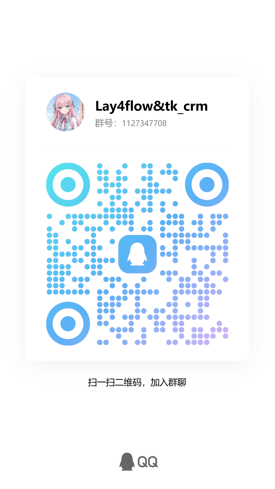

## 社区

本开源项目已链接并认可 [LINUX DO 社区](https://linux.do/)。

## 许可证与归属

采用 [MIT](LICENSE) 许可证，保留原始版权声明及 [NOTICE](NOTICE)。产品名称为 **lay4flow-remote**。
