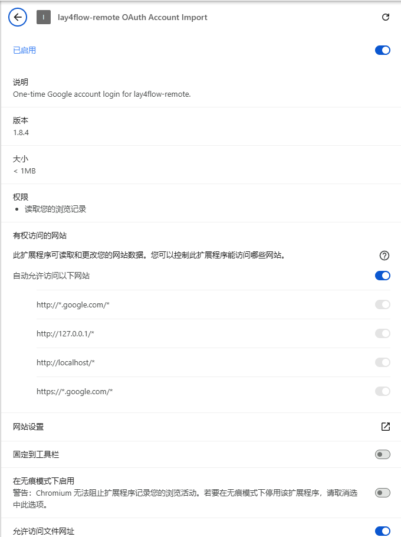
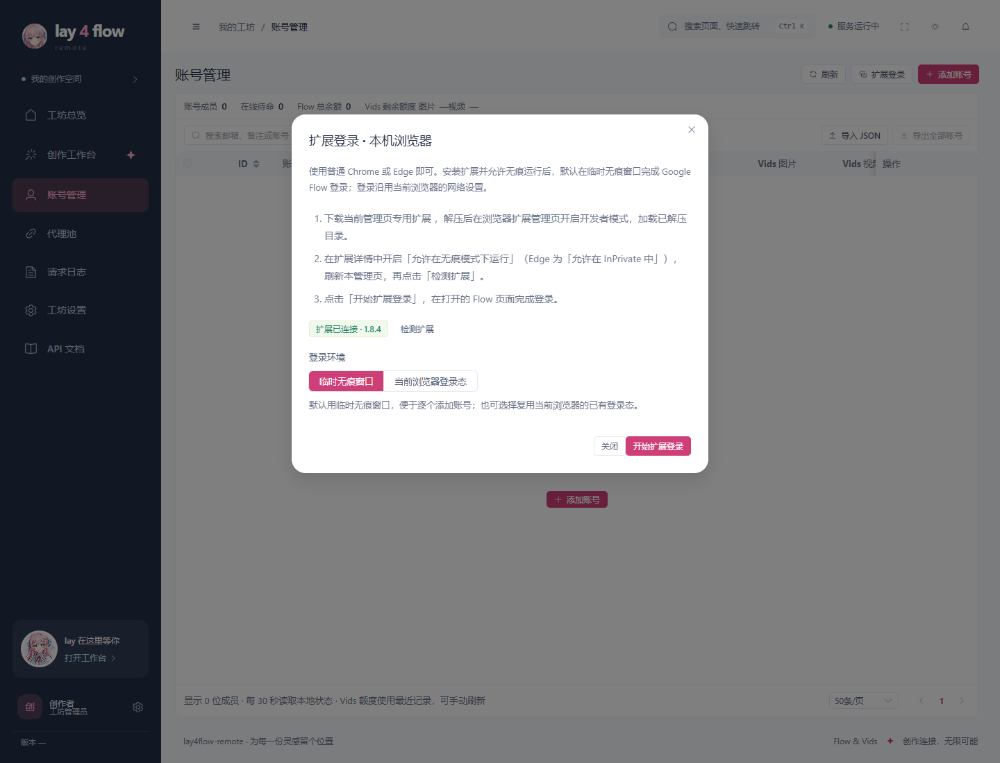

# 用 Chrome／Edge 扩展添加账号

扩展当前版本 **1.8.4**。Windows 桌面版和 Docker 版使用同一扩展协议；普通 Chrome 或 Microsoft Edge 即可，不要求指纹浏览器。扩展只负责登录资料采集，Flow 验证码始终交给远程 `remote_browser` 服务。

## 从当前管理页安装

1. 在普通 Chrome／Edge 窗口打开管理地址，例如 `http://127.0.0.1:38001/#/accounts`，登录管理员账号。
2. 点击「扩展登录 → 下载当前管理页专用扩展」，把 ZIP 解压到长期保留的文件夹。更新扩展时覆盖同一文件夹，不要加载 ZIP 本身。
3. 打开 `chrome://extensions` 或 `edge://extensions`，开启右上角「开发者模式」，点击「加载已解压的扩展程序」，选择包含 `manifest.json` 的目录。
4. 打开这份扩展的「详情」，启用「允许在无痕模式下运行」；Edge 对应「允许在 InPrivate 中」。只安装一份当前扩展，停用旧副本。
5. 重新加载扩展，然后刷新管理页；回到「扩展登录」点击「检测扩展」。看到绿色的 **扩展已连接 · 1.8.4** 后再开始。



图中无痕开关尚未开启；使用默认临时无痕方式前，请把该开关打开。



图片在隔离 Chromium 中实际加载本项目扩展拍摄，后台 API 使用合成数据，没有真实账号。

## 两种登录方式

| 方式 | 适合场景 | 登录完成后 |
|---|---|---|
| 临时无痕窗口（默认） | 逐个添加不同账号 | 提交收到后台回执后关闭本次窗口、清理本次临时 Google 登录资料 |
| 当前浏览器登录态 | 浏览器已经登录目标 Google 账号 | 保留原浏览器登录态，只关闭本次新建的 Flow 标签 |

默认方式开始前先关闭已有无痕／InPrivate 窗口。Chrome 的多个无痕窗口共享 Cookie 空间，扩展会拒绝与现有无痕会话混用；不会清除其他窗口的登录态。

点击「开始扩展登录」，在新开的 Flow 页面完成 Google 登录。页面收到登录资料后显示「已安全保存，后台验证中」，此时可以继续添加下一个账号；最终结果在账号页的「扩展登录队列」查看。排队不等于验证成功。失败时显示具体原因，由用户手动重试，不自动重试两次，也不强制重开两次 Profile。

已有账号再次通过扩展登录时，更新原账号登录资料，沿用固定代理、浏览器身份和账号设置；验证失败保留原 Profile。账号忙碌时先结束当前生成、维护或账号浏览器操作再更新。

## Windows 安装版在哪里操作

软件里的内嵌 WebView2 不运行 Chrome 扩展。请在「账号管理 → 扩展登录」点击「在本机浏览器中打开」，软件会打开本机 Chrome／Edge 管理页。仍用同一套后台和账号数据，完成后回到软件点击「刷新账号」。

Google 登录采用普通浏览器当前的网络设置；扩展不读取或修改浏览器代理。后台接收后按账号固定代理校验与保存，网络策略由两侧分别配置。安装版的 Cloak 用于后台 Profile 保存、会话恢复和手动账号浏览器，不是扩展登录要求使用的浏览器，也不参与本地验证码生成。

## 加载源码目录与下载专用包有什么区别

| 加载方式 | 管理页权限 | 地址变化后 |
|---|---|---|
| 直接加载仓库 `account_import_extension` | 预置 `http://127.0.0.1/*` 与 `http://localhost/*`；远程站点需点击工具栏扩展图标授权 | 本机两个名称和各端口自动匹配；远程新地址需重新授权 |
| 管理页下载的专用 ZIP | 预置生成 ZIP 时的管理地址；不申请任意站点访问或动态脚本权限 | 更换协议、主机或端口后，从新管理页重新下载并加载 |

Chrome 的省略端口匹配模式覆盖所有端口，见 [Chrome 官方匹配规则](https://developer.chrome.com/docs/extensions/develop/concepts/match-patterns)。扩展提交仍逐次核对当前管理页的完整来源地址，并要求管理员绑定的一次性回执；不会把其他地址的登录资料转发过来。

## 看见「扩展未连接」时

| 检查 | 操作 |
|---|---|
| 窗口是软件内嵌页面 | 点击「在本机浏览器中打开」，在普通 Chrome／Edge 操作 |
| 装在另一个浏览器或另一个浏览器用户中 | 在当前管理页所在的浏览器用户下安装并启用 |
| 有多份旧扩展 | 停用旧副本，仅保留当前目录；扩展详情确认版本 1.8.4 |
| 站点权限不对 | 核对当前管理地址；专用包从当前地址重下，源码版远程站点点击工具栏图标授权 |
| 修改源码后仍旧状态 | 在扩展管理页点重新加载，再刷新管理页，重新检测 |
| 无痕权限未开 | 在扩展详情开启无痕／InPrivate；普通窗口的检测成功不代表无痕权限已开启 |

「未连接」表示网页还没收到桥接响应，并不表示已经判断你的扩展版本过旧。只有连接后才会显示检测到的版本并比较兼容性。

## 管理员打包

```powershell
python scripts/build_account_import_extension.py --origin http://127.0.0.1:38001 --output dist/1.6.1/lay4flow-remote-login-extension-1.8.4-38001.zip
```

输出使用显式文件清单：`manifest.json`、三个脚本、说明、`LICENSE` 和 `NOTICE`；不包含 Cookie、账号导出、数据库、Profile 或本地配置。扩展没有独立的 Windows 安装步骤；EXE 安装后台后，仍从对应管理页下载扩展并在 Chrome／Edge 加载。

真实 Google 登录、代理可达性与账号挑战需在使用环境单独验证。项目的离线验收包括真实 MV3 扩展检测、模拟 Chrome API 的采集／清理、后台身份与一次性回执测试，不把模拟测试写成真实登录成功率。
