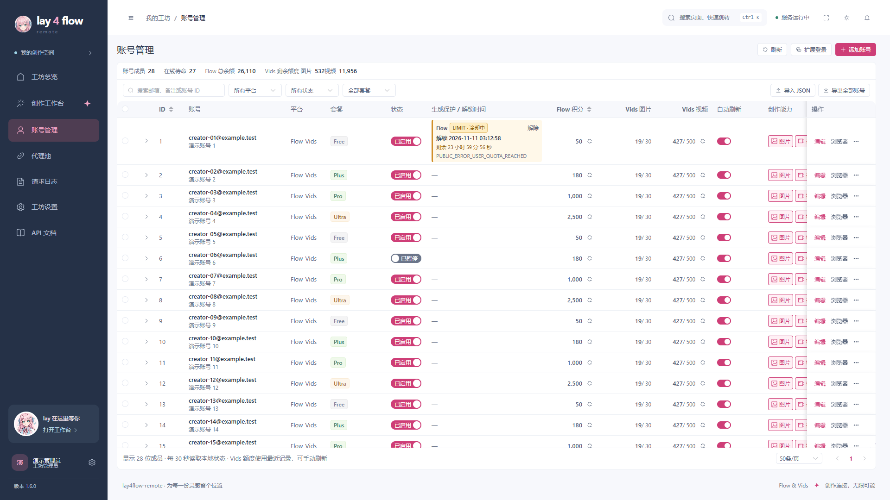
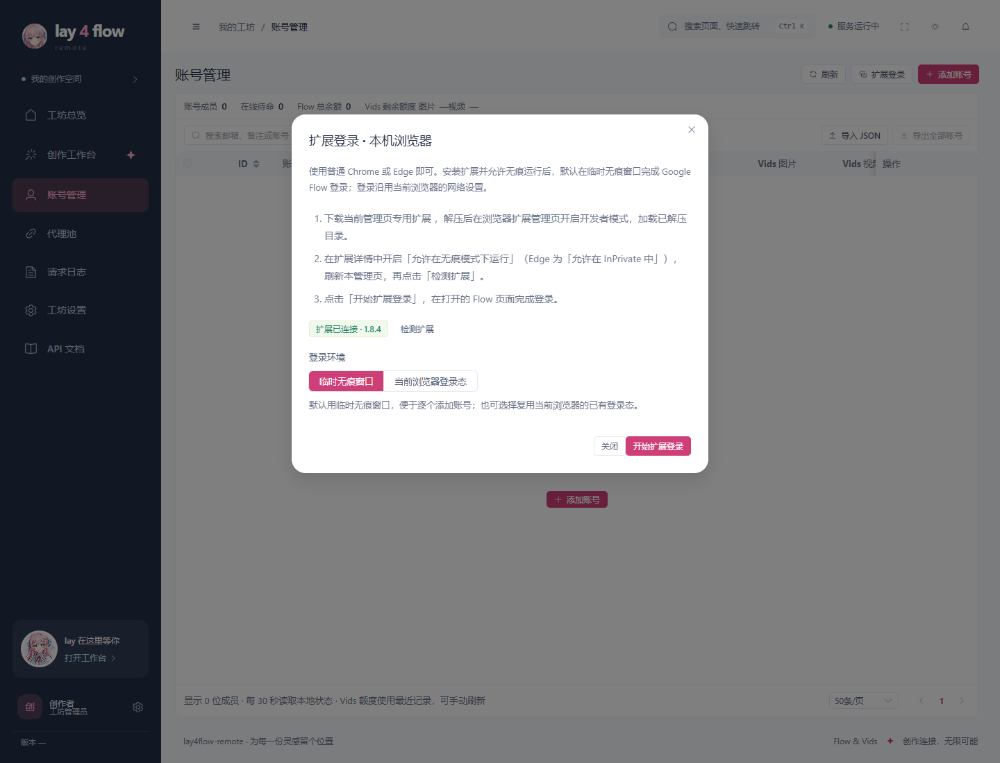
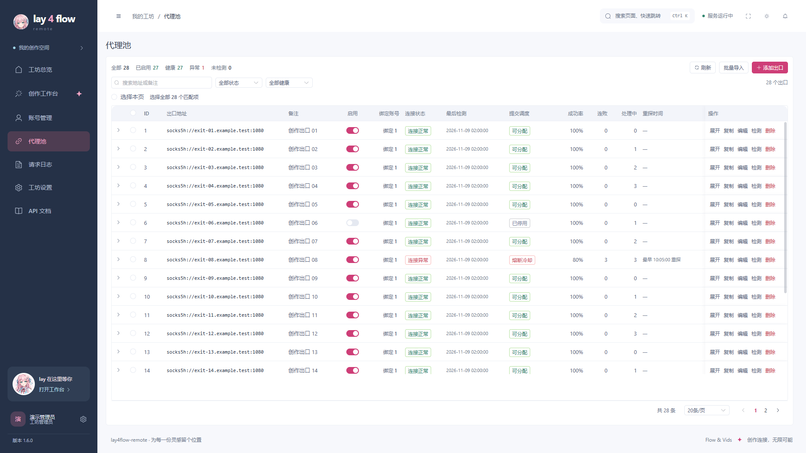
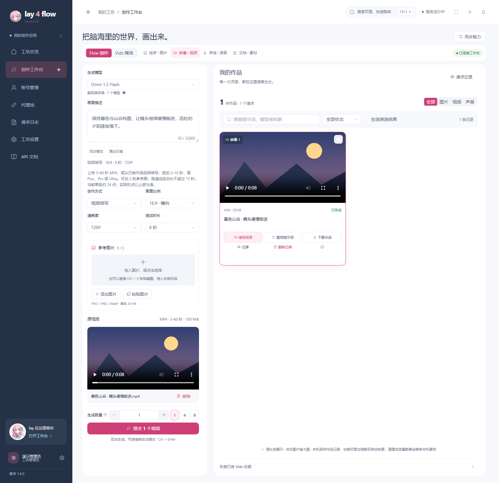
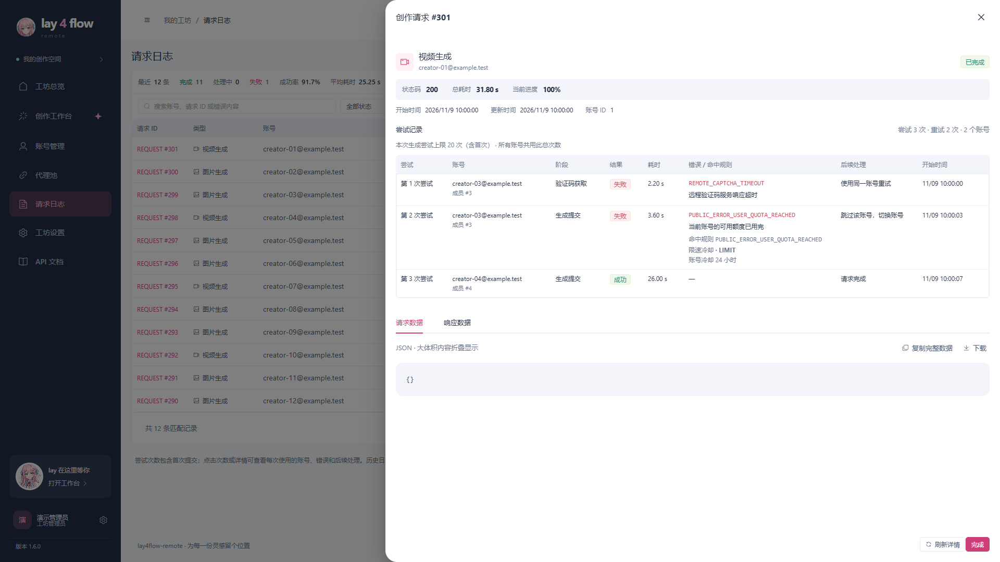
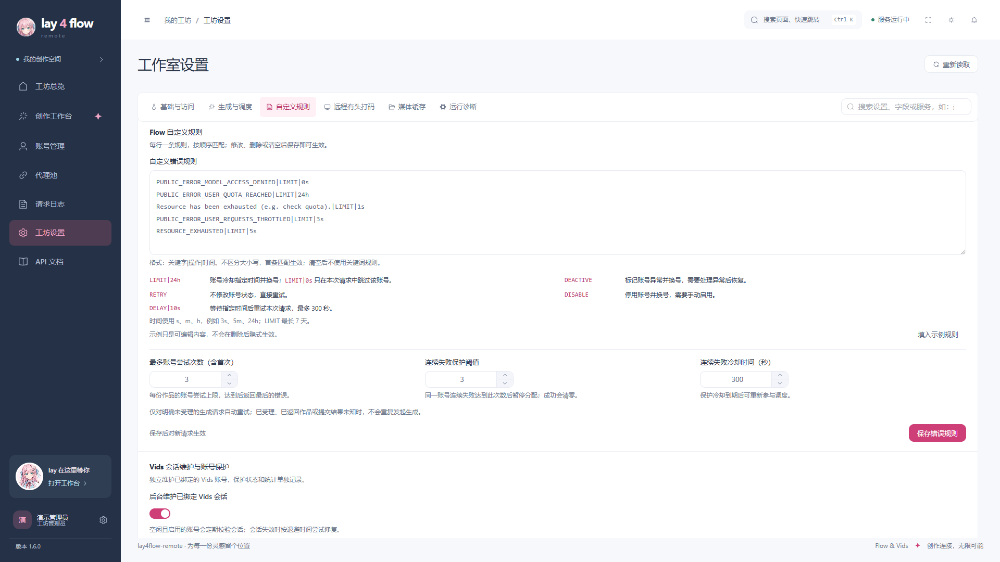

# Windows 安装与使用

适用 Windows 10 / 11 x64。下载 [Releases](https://github.com/TheLayya/lay4flow/releases) 中的 `lay4flow-remote-1.6.1-windows-x64-setup.exe`，双击后按向导安装，完成后打开桌面上的 **lay4flow-remote**。也可下载同版本 ZIP，完整解压后运行 `install.cmd`。

安装包自带原生后台、Python 运行时、依赖和 Cloak 浏览器，**无需安装 Docker、Python、Node、Git 或 .NET**。应用自身依赖已打包；桌面界面使用 Microsoft Edge WebView2，缺失时安装器会运行微软官方安装程序，此步骤需要联网。生成内容还需要可访问 Google 和远程打码服务的网络。

## 1. 安装并登录管理页

默认安装目录为 `%LOCALAPPDATA%\lay4flow-remote`，服务只监听本机。默认端口 `38000`，安装器遇到端口冲突会选择空闲端口，实际值保存在安装目录 `.env`。以桌面端打开的地址为准，不要把其他服务的 `38000` 或 `38001` 当作本次安装地址。

首次管理员名称与密码均为 `admin`，登录后到「工坊设置 → 基础与访问」修改。API 访问密钥也在这里设置，外部客户端调用 API 时使用。

ZIP 用户如需自定义目录和端口，在解压目录运行：

```powershell
powershell.exe -NoProfile -ExecutionPolicy Bypass -File .\install.ps1 -InstallDir "D:\lay4flow-remote" -Port 38001
```

下图为账号管理界面。套餐、额度、开关与会话状态分列显示；账号表格会使用窗口剩余高度。



> 本文界面图由当前应用与模拟服务渲染。邮箱、账号、出口、额度和日志均为演示数据，不包含真实登录态；视频画面为本地绘制示例。

## 2. 添加账号：扩展登录或内置账号浏览器

两种入口都把账号保存到本机服务中，生成和登录态维护继续按账号绑定的固定代理执行。

| 入口 | 使用的浏览器 | 适合情况 |
|---|---|---|
| 「扩展登录」 | 本机普通 Chrome 或 Edge | 在临时无痕窗口登录，或复用该浏览器已有 Google 登录态 |
| 「添加账号」／账号行「浏览器」 | 安装包自带的 Cloak | 通过本机原生窗口登录、补验证或维护已有账号 Profile |

扩展登录的操作顺序：

1. 在桌面端进入「账号管理 → 扩展登录」，使用窗口中的按钮打开本机浏览器管理页。程序优先使用已安装的 Chrome，其次 Edge。
2. **在刚打开的普通浏览器管理页中**下载当前地址专用扩展 ZIP，解压；进入 `chrome://extensions` 或 `edge://extensions`，开启开发者模式，选择「加载已解压的扩展程序」，选中包含 `manifest.json` 的目录。
3. 打开该扩展的详情，开启 Chrome 的「允许在无痕模式下运行」或 Edge 的「允许在 InPrivate 中」。回到普通窗口的管理页，刷新并点击「检测扩展」。
4. 扩展显示已连接后，选择「临时无痕窗口」并开始登录，在新窗口完成 Google Flow 登录；也可选择「当前浏览器登录态」复用普通窗口已有会话。
5. 登录资料提交后进入后台导入队列；回软件账号页查看结果。后台在固定代理上验证一次真实身份后保存，失败项会显示原因，不自动重开浏览器两次。



软件内嵌的 WebView2 不加载 Chrome 扩展，扩展检测和 Google 登录需要在刚打开的 Chrome／Edge 中完成。Google 登录沿用该浏览器网络，扩展不会修改其代理；服务器收到登录态后按原规则分配或沿用账号固定出口。

直接加载源码 `account_import_extension` 文件夹也支持本机 `127.0.0.1`、`localhost` 管理页。站点专用 ZIP 则预置下载时的管理地址；更换服务器、域名或端口后，从新的管理页重新下载并加载。更多说明见 [扩展登录指南](EXTENSION_LOGIN.md)。

已有账号再次通过扩展或 JSON 导入时，更新原账号登录态，保留原固定代理、指纹和能力设置。账号正在生成、刷新或打开浏览器时，先结束当前操作。已有外部 Cookie JSON 可在「导入 JSON」中粘贴或选择文件，无需重新手工登录。

## 3. 配好网络与远程打码

在「代理池」添加账号出口，再为账号选择固定代理；留空时由服务自动分配。支持批量粘贴 `IP:端口:用户名:密码`，一行一个，未指定协议默认使用远端 DNS 的 `socks5h://`。



Windows 桌面启动时自动解析系统代理和 PAC，并检测 Clash、Mihomo、sing-box 等代理程序的实际监听端口，通过 HTTP CONNECT 或 SOCKS5 握手后接入。无需固定使用某个端口，也不要求开启 TUN。账号绑定的代理仍是最终出口，可在「工坊状态 → 宿主网络」查看检测结果。

需要手动指定时，在安装目录 `.env` 设置后重新打开桌面端：

```dotenv
LAY4FLOW_HOST_PROXY_MODE=manual
LAY4FLOW_HOST_PROXY=http://127.0.0.1:7890
```

将示例 `7890` 替换成代理程序实际端口。自动检测使用 `LAY4FLOW_HOST_PROXY_MODE=auto`；直连使用 `LAY4FLOW_HOST_PROXY_MODE=direct`。检测记录在 `data/host-network.json`。

在「工坊设置 → 远程有头打码」填写从 [打码服务](https://cap.tk218.top/) 申请的 API Key。Flow 验证码由 `remote_browser` 提供；内置 Cloak 和登录扩展负责账号登录，不承担本地验证码求解。

## 4. 使用 Omni 1.2 Flash

进入「创作工作台 → Flow 创作 → 视频」，选择 Omni 1.2 Flash。文生、单图和参考图模式提供 3–15 秒；首尾帧支持 3–10 秒，套餐和具体可用组合以当前目录校验为准。

续写有两个入口：选择「视频续写」后上传 3–60 秒、最大 100 MiB 的 MP4；或直接点击已有视频作品上的「续写视频」。程序自动准备素材并处理媒体编号，用户只需修改描述、选择追加时长并点击提交。**选择素材不会自动生成，也不需要填写媒体 ID。**



续写追加 3–10 秒，可添加最多 3 张参考图，需要 Plus、Pro 或 Ultra。1080p／4K 的续写成品总时长不超过 15 秒；程序会在付费提交前检查当前套餐和放大权限。Omni 1.1 仍保留独立入口，旧请求不会自动切换到新模型。

## 5. 查看错误与重试

「请求日志」表格直接显示尝试次数、重试次数和使用账号数。点击次数或请求详情，可逐次查看账号、验证码／提交阶段、耗时、具体错误、命中规则和后续处理。历史日志没有记录次数时会显示「次数未记录」。



在「工坊设置 → 自定义规则」逐行编辑错误关键词及动作，保存后对新请求生效。`LIMIT`、`DEACTIVE`、`RETRY`、`DISABLE`、`DELAY` 的含义在输入区下方说明；清空并保存后不再使用关键词规则。连续失败阈值与冷却时间也在同一处设置。



## 启动、停止与升级

| 操作 | 入口与结果 |
|---|---|
| 启动 | 桌面快捷方式或安装目录的 `start.cmd` |
| 关闭桌面窗口 | 后台已提交任务继续处理 |
| 停止服务 | `stop.cmd` 正常停止后台并关闭账号 Profile |
| 升级 | 下载新版安装包，覆盖安装到原目录；保留配置、账号和 Profile |
| 卸载 | `uninstall.cmd` 移除程序入口和所属快捷方式，保留 `.env`、`config`、`data`、`tmp` |

左下角版本号可打开更新日志并检查更新。更新包先校验，退出桌面后安装；后台与资料会先备份，健康和版本检查失败时按升级流程恢复。更新前等待生成、导入和登录操作结束。

Docker 容器更新不会自动更新 Windows 安装目录。使用 Windows 桌面版需要安装对应新版 EXE／ZIP；相同版本可重新安装刷新程序，旧版安装包不会覆盖新版。旧 Docker 桌面版覆盖升级时，安装器按目录确认归属后停止原服务，保留其他 Docker 项目；外部程序占用原端口时自动选择空闲端口。

正常生成、素材上传、轮询和媒体查询使用保存的账号 HTTP 会话，不会为每次生成打开本机 Cloak。日常维护优先 HTTP，必要时后台恢复登录态；只有主动登录或点击「浏览器」才打开可见窗口。正常关闭 Profile 后只清理可再生缓存，保留 Cookie、站点存储和身份资料。

安装日志：`%TEMP%\lay4flow-remote-install.log`。后台日志：安装目录 `data\native-service.log` 和 `data\native-service.log.error`。桌面菜单「应用 → 启动日志」可查看启动详情。

## 维护者打包

以下命令从项目根目录执行。新建后端运行时时输出目录必须不存在，Cloak 参数指向已验证的完整公开浏览器目录中的 `chrome.exe`；不要以账号 Profile 或用户浏览器资料目录作为构建来源。

```powershell
npm.cmd --prefix frontend test
npm.cmd --prefix frontend run build
python scripts/check.py

$releaseVersion = (Get-Content -LiteralPath VERSION -Raw).Trim()
$releaseDir = "dist/$releaseVersion"
python scripts/build_native_runtime.py desktop/runtime/backend/windows-x64 --cloak-binary "C:/path/to/verified-cloak/chrome.exe"
powershell.exe -NoProfile -ExecutionPolicy Bypass -File scripts/build_desktop.ps1
python scripts/build_release.py $releaseDir --desktop-runtime desktop/runtime/windows-x64 --backend-runtime desktop/runtime/backend/windows-x64
powershell.exe -NoProfile -ExecutionPolicy Bypass -File scripts/build_windows_setup.ps1 -BundleZip "$releaseDir/lay4flow-remote-$releaseVersion-windows-x64.zip" -OutputDir $releaseDir
```

桌面构建需要 .NET 10 SDK，EXE 构建需要 Inno Setup 6；这些是维护者的构建依赖，最终用户无需安装。包内后端运行时可在依赖未变且清单校验通过时复用，应用源码与前端资源需重新打包。

发布目录中的 `SHA256SUMS` 和 `build-manifest.json` 记录公开运行包、Windows ZIP 和 EXE 的校验值。应用源码包按白名单生成，真实账号、密钥、数据库、Profile、日志和生成内容不会进入发布包。安装器当前没有 Authenticode 签名；构建通过不等于已完成真实 Google 登录或付费生成验收，这两项需要在实际网络与账号环境另行验证。
